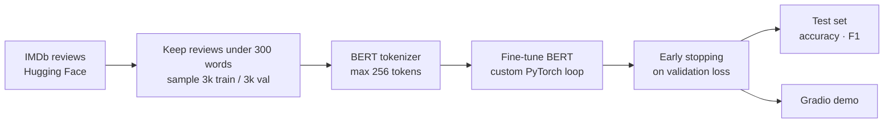

# IMDb Sentiment Classifier: fine-tuned BERT

This project fine-tunes `bert-base-uncased` to classify movie reviews as positive or negative. It uses a hand-written PyTorch training loop with early stopping and includes a Gradio demo for trying the model on your own text.

**Result:** **88.8% accuracy** and **0.880 F1** on 3,000 held-out IMDb test reviews.

## Approach

- **Data:** the [stanfordnlp/imdb](https://huggingface.co/datasets/stanfordnlp/imdb) dataset. I kept reviews under 300 words so they fit BERT's input length, then sampled 3,000 training and 3,000 validation reviews. The classes are balanced.
- **Training:** a custom training loop rather than the `Trainer` API, to keep full control over each step. It uses AdamW (learning rate 5e-5, weight decay 0.01) with a linear learning-rate schedule and runs for up to 5 epochs.
- **Model selection:** precision, recall and F1 are tracked on the validation set every epoch. The best checkpoint by validation loss is saved, and training stops early if validation loss doesn't improve for 2 epochs.
- **Evaluation:** a separate sample of 3,000 reviews from the official test split, never seen during training.
- **Demo:** a Gradio app that returns the predicted label with a confidence score.

## Run it

Open `Portfolio_Assignment_2_.ipynb` in Google Colab with a GPU runtime and run the cells in order. The dataset and pretrained model download automatically from Hugging Face.

## Limitations and next steps

- Training used a 3,000-review subset to keep compute manageable. The full 25,000-review training set would likely improve accuracy.
- Reviews over 300 words were excluded. Handling them with chunking or a longer-context model would make the model usable on real-world text.
- A TF-IDF + logistic regression baseline would show how much the transformer actually adds.
- The demo shows a confidence score, but its calibration hasn't been checked. A reliability diagram would show whether "0.95 confident" really means right 95% of the time.

## Tech stack

Python · PyTorch · Hugging Face Transformers & Datasets · scikit-learn · Gradio

## Citation

Maas et al. (2011). *Learning Word Vectors for Sentiment Analysis.* ACL 2011. [Paper](http://www.aclweb.org/anthology/P11-1015)
